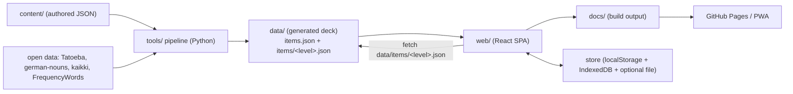

# Architecture

## Overview

Stufe is a **static** app: no server, no database. All study logic runs in the
browser; progress is stored in `localStorage`, mirrored to IndexedDB, and can be
backed up to a user-chosen file. Core design choices are recorded in
[`decisions.md`](decisions.md).

```
┌────────────┐   build   ┌────────────┐   serve   ┌──────────────┐
│  web/ (TS) │ ────────► │  docs/     │ ────────► │ GitHub Pages │
└────────────┘           └────────────┘           └──────────────┘
       │ fetch data/items/<level>.json
       ▼
┌────────────┐  generate  ┌────────────┐  author  ┌────────────┐
│  data/     │ ◄───────── │  tools/    │ ◄──────── │ content/   │
└────────────┘            └────────────┘           └────────────┘
```



## The app (`web/`)

Vite + React 18 + TypeScript (strict) + Tailwind + Radix primitives styled in the
shadcn manner. `HashRouter` so deep links work on a project Pages site;
`base: "./"` keeps asset URLs relative.

```
web/src/
  main.tsx            ReactDOM root; ThemeProvider; HashRouter; store->IDB/backup wiring
  App.tsx             shell: sidebar (desktop) / drawer (mobile), routes, ErrorBoundary, Shortcuts
  index.css           Tailwind layers + design tokens (CSS variables, dark theme)
  lib/                pure, unit-tested logic (no React) — see below
  components/ui/      Button, Card/Stat, Tabs, Select, Switch, Progress, Accordion, Chip
  components/         Art, ErrorBoundary, Onboarding, Shortcuts
  hooks/              useDeck (data), useProgress (store), useStudy (session machine)
  routes/             one file per screen
```

`lib/`: `srsCore`, `stages`, `stats`, `projection`, `grade`, `judge`,
`selectors`, `store`, `data`, `cloze`, `gloss`, `search`, `i18n`, `cefr`,
`tts`, `persist`, `backup`, `asr`, `shuffle`, `cn`, `theme`. Each has a
`*.test.ts` where it is pure logic.

### Design tokens & theming

Colours are CSS variables in `index.css` (`--bg`, `--surface`, `--ink`,
`--muted`, `--line`, `--soft`, `--der`, `--die`, `--das`, `--good`, `--bad`).
Dark mode is `[data-theme="dark"]` on `<html>`; `ThemeProvider` resolves
`auto | light | dark` and persists to `localStorage` (`stufe-theme`). Text size
scales the root font size.

### State & durability

`lib/store.ts` is a tiny observable over `localStorage["stufe-progress-v2"]`:

```ts
{ p: Record<itemId, Entry>, history: Record<dayKey, {new, reviews}>, settings }
```

Components read it via `useProgress()` (`useSyncExternalStore`); mutations go
through `store` (`grade`, `setEntry`, `reschedule`, `resetItem`, `suspend`,
`markKnown`, `log`, `setSettings`, `import`, `export`, `reset`). Every commit is
mirrored to **IndexedDB** (`lib/persist.ts`) and, if the user granted one,
written to a **backup file** via the File System Access API (`lib/backup.ts`).
On startup, if `localStorage` is empty, the IndexedDB copy is restored.

### Data loading

`lib/data.ts` loads `data/levels.json` and `data/reading.json` eagerly, then
streams the deck per level from `data/items/<level>.json`. `by` grows as levels
arrive; `subscribeDeck` notifies `useDeck()`, which exposes
`{ levels, by, reading }`. `scripts/sync-data.mjs` copies an **allowlist** of the
generated files into `web/public/data/`, so build-time inputs (the frequency
deck, a personal Anki import) never ship to the client.

### Routing

`App.tsx` groups routes Learn / Practice / You:

| Route | Screen |
| --- | --- |
| `/` | Today (dashboard, onboarding, up-next) |
| `/study` | Study (lesson / review / practice / checkpoint; `?group=&level=&mode=`) |
| `/browse` | Browse (Course / Vocabulary; POS + top-by-frequency) |
| `/grammar`, `/grammar/:level/:group` | Grammar library + point page |
| `/reading`, `/reading/:id` | Reading library + passage (tap-a-word glossing) |
| `/listening`, `/dictation`, `/translate` | listening / dictation / production drills |
| `/pronunciation`, `/speaking`, `/writing` | alphabet, speech check, writing feedback |
| `/search` | Search (words + grammar points) |
| `/stats` | Stats (Overview / Levels / Projections) |
| `/settings`, `/credits`, `/help` | settings and info |

`#/study?group=<id>&level=<i>` starts a group lesson; `&mode=practice` a practice
session; `&mode=checkpoint&level=<i>` a scored level checkpoint.

## The pipeline (`tools/`)

Python 3, standard library only. Commands, schema and provenance live in
[`content.md`](content.md) and [`../tools/README.md`](../tools/README.md);
summary:

- `fetch_sources.py` / `fetch_kaikki.py` — download the pinned raw sources.
- `build_cefr.py` — frequency-anchored CEFR bands → `data/cefr.json` (ADR-4).
- `build_frequency.py` — POS-aware frequency deck (article, plural, gloss, IPA,
  audio, examples, `freqRank`) → `data/vocab_frequency.json`.
- `build_conjugations.py` — present/preterite/participle for deck verbs.
- `build_ipa.py` — IPA + native-audio URLs for the curated vocabulary.
- `build_reference.py` — a Wiktionary noun reference for cross-checking.
- `build_dataset.py` — merges `content/` + generated inputs into
  `data/items.json`, `data/items/<level>.json`, `levels.json`, `reading.json`,
  `attribution.json`; also adds drill tracks, examples, mnemonics and `source`.
- `verify_dataset.py` / `cross_check.py` / `verify_report.py` — checks (ADR-6/7).

## Deployment

`.github/workflows/pages.yml` uploads `docs/` as the Pages artifact;
`.github/workflows/ci.yml` runs the Python checks + web build/unit/e2e/a11y.
Both trigger on push to `main`. No runtime server. A service worker
(`web/public/sw.js`, cache `stufe-v3`) precaches the **shell + deck**, serves
hashed assets cache-first and data/index network-first (ADR-9).

## Data & privacy

Everything runs locally; progress never leaves the device. Progress is kept in
`localStorage`, mirrored to IndexedDB, and optionally backed up to a file the
user chooses (ADR-8). Backups can also be exported/imported from Settings
(JSON).
